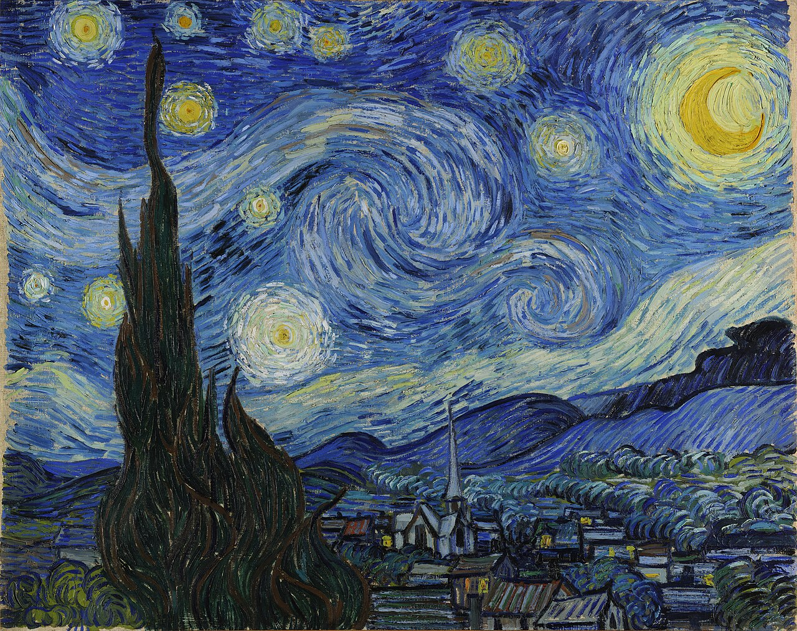
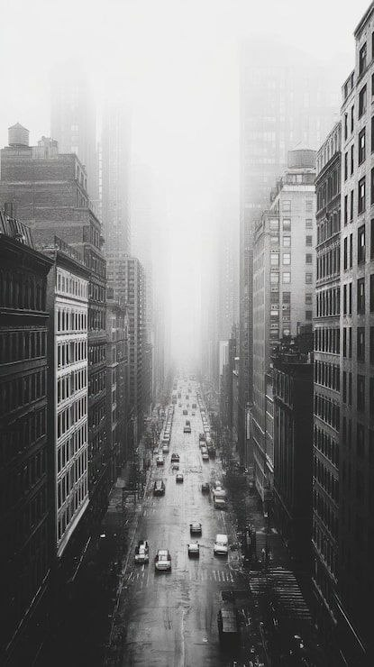
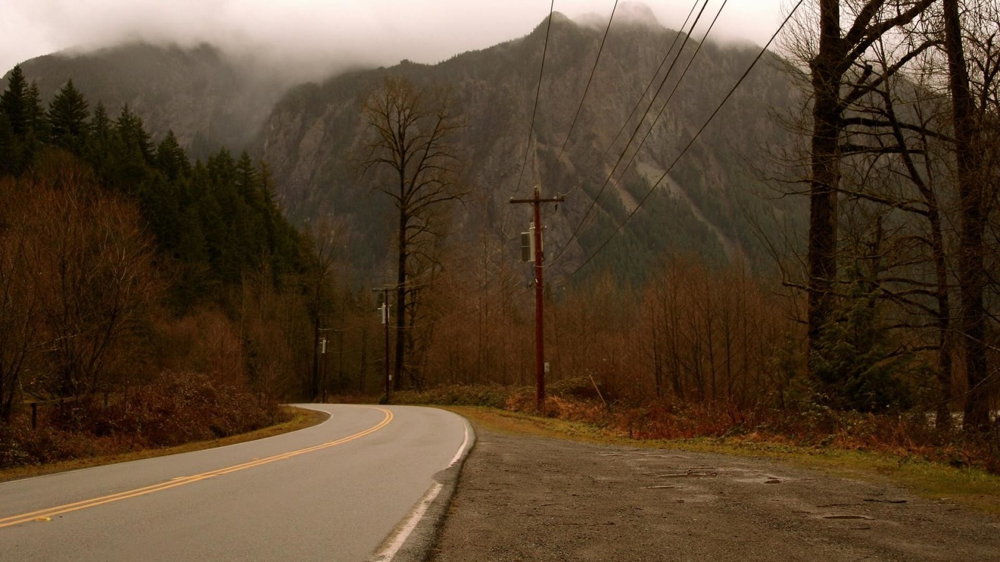
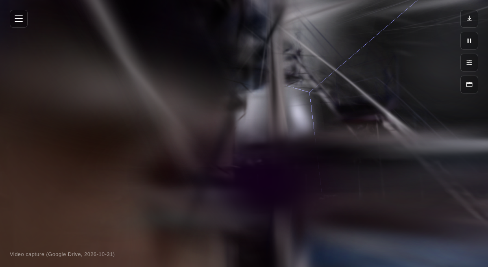
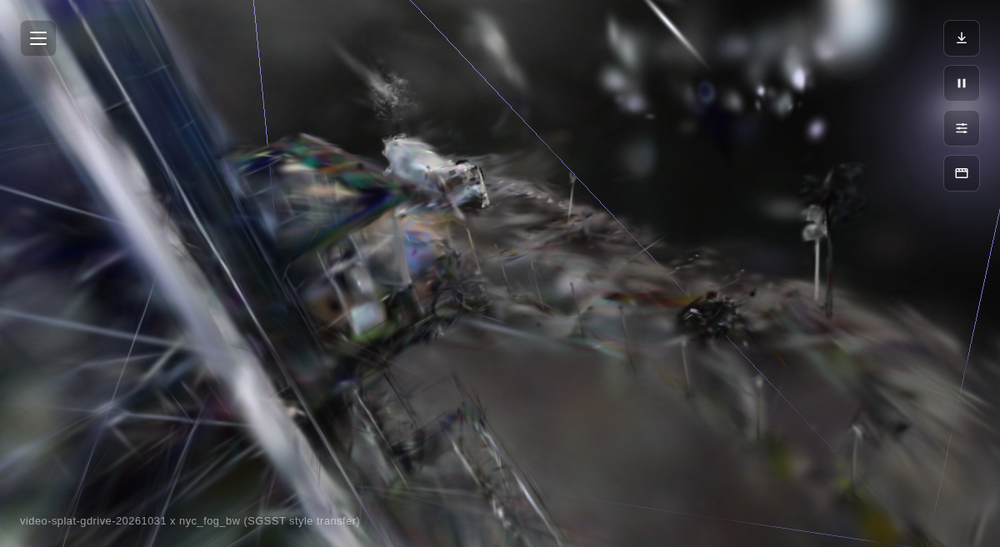
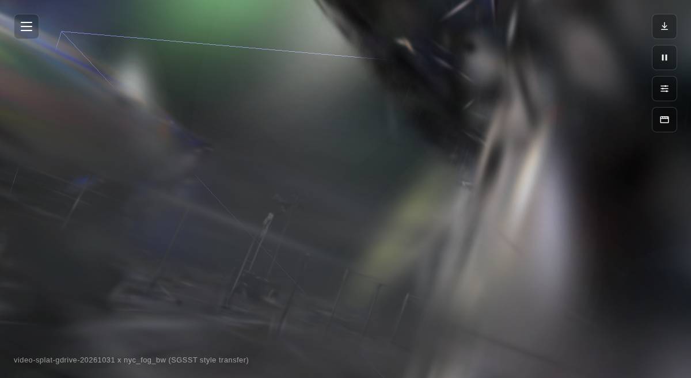

# SGSST Splat Style Transfer

Apply artistic style transfer to a trained 3D Gaussian Splat using
**SGSST: Scaling Gaussian Splatting Style Transfer**
([Galerne, Wang, Raad, Morel — arXiv:2412.03371](https://arxiv.org/abs/2412.03371)),
scoped to run on a single **6GB-class consumer GPU** instead of the
paper's 80GB A100.

This repo does **not** reimplement SGSST or vendor its code — it is a set
of small patches against the original SGSST/gaussian-splatting/SPST
repos (to fix API-version mismatches and add memory-bounded execution
modes), plus wrapper scripts and documented usage.

## Test subject used throughout this README

All examples below use **`video-splat-gdrive-20261031`** — the same
~700-frame, ~101,000-Gaussian indoor scene used as the reference example
in the companion [gaussian-splatting-pipeline](https://github.com/n2048-creative-technology/gaussian-splatting-pipeline)
repo. It's a real, moderately dense scene, not a cherry-picked easy case.

### Style reference images used

| Style image | Used in |
|---|---|
|  `starry_night.jpg` | Van Gogh's *Starry Night* — classic strong-palette/strong-texture style transfer test case |
|  `nyc_fog_bw.jpg` | Dark, foggy, high-contrast black & white street photo — used for the examples below |
|  `lynch_fog.jpg` | Misty forest/mountain road, dark cinematic palette (David Lynch / Twin Peaks reference) |

### Results on `video-splat-gdrive-20261031` + `nyc_fog_bw.jpg`

| Original (unstyled) | Fast mode | Quality mode (real multi-scale) |
|---|---|---|
|  |  |  |
| Trained splat, no style transfer | `mode=fast`, ~10-15 min | `mode=quality`, real run: **~7.5 hours** |

Both result images show visible dark/desaturated noir-style influence
from the style image, applied to the real trained geometry — not a
flat filter.

## Setup

1. Clone this repo.
2. Clone SGSST and its style-transfer-loss dependency inside it:

   ```bash
   git clone https://github.com/JianlingWANG2021/SGSST.git SGSST
   cd SGSST
   git clone https://github.com/bgalerne/scaling_painting_style_transfer.git
   cd ..
   ```

3. Apply this repo's patches (fixes API mismatches against a modern
   `diff-gaussian-rasterization` build, and adds the memory-bounded
   `quality` mode — see "What the patches do" below):

   ```bash
   for p in patches/*.patch; do patch -d SGSST -p1 < "$p"; done
   ```

4. Download the VGG19 weights SGSST's style loss needs:

   ```bash
   mkdir -p SGSST/scaling_painting_style_transfer/model
   # via gdown, or download manually and place at the path below:
   pip install gdown
   python3 -c "import gdown; gdown.download('https://drive.google.com/uc?id=1lLSi8BXd_9EtudRbIwxvmTQ3Ms-Qh6C8', 'SGSST/scaling_painting_style_transfer/model/vgg_conv.pth', quiet=False)"
   ```

5. Make sure `SGSST/`'s Python environment has a working
   `diff-gaussian-rasterization` + `simple-knn` build (the same CUDA
   extensions used by a standard gaussian-splatting training setup — see
   the companion [gaussian-splatting-pipeline](https://github.com/n2048-creative-technology/gaussian-splatting-pipeline)
   repo's requirements). These patches were verified against a build with
   a **newer rasterizer API** than SGSST's pinned 2023-era commit expects
   (see "What the patches do").

## Usage

```bash
./scripts/stylize_splat.sh <splat_project_dir> <style_image> <output_name> [mode] [iterations]
```

`<splat_project_dir>` must contain:
- `<splat_project_dir>/undistorted/sparse/0/` (COLMAP's undistorted output)
- `<splat_project_dir>/output/point_cloud/iteration_7000/point_cloud.ply`
  (a trained splat — e.g. from the companion gaussian-splatting-pipeline repo)

Example (the exact commands used to generate the results above):

```bash
SGSST_ENV=gs ./scripts/stylize_splat.sh \
  ~/projects/gaussian-splatting/video-splat-gdrive-20261031 \
  examples/styles/nyc_fog_bw.jpg \
  gdrive-nycfog \
  fast

SGSST_ENV=gs ./scripts/stylize_splat.sh \
  ~/projects/gaussian-splatting/video-splat-gdrive-20261031 \
  examples/styles/nyc_fog_bw.jpg \
  gdrive-nycfog-multiscale \
  quality
```

`SGSST_ENV=gs` tells the script to run inside a conda/micromamba
environment named `gs`; omit it to just use `python3` on `PATH`.

Optionally set `REGISTER_CMD` to a script that takes
`<ply_path> <output_name> "<label>"` to auto-register the result
somewhere (e.g. the companion pipeline repo's `scripts/add_splat.sh`).

### `fast` vs `quality` modes

| | `fast` (default) | `quality` |
|---|---|---|
| Resolution | Downscaled (`--resolution 2`) | Full (`--resolution 1`) |
| Multi-scale SOS loss (SGSST's actual contribution) | **Never reached** — single-scale optimization only | **Genuinely reached** after a short pre-optimization phase |
| Image loading | All training images decoded once, held in memory | Lazy per-access disk loading — bounded peak memory regardless of dataset size |
| VGG loss tiling | 512px tiles | 256px tiles (lower peak VRAM, same final math — just more sequential tiles) |
| Real measured runtime (699-camera, 101k-Gaussian scene, RTX 3050 6GB) | ~10-15 minutes | **~7.5 hours** |
| When to use | Previewing a style choice before committing | Final output, run unattended overnight |

## What the patches do

Five small patches against upstream code, all in `patches/`:

- **`stylize.py.patch`** — adds a `--vgg_block_size` CLI argument (wired
  into every `VGG_BY_BLOCKS` call site) and a `--optimize_iteration`
  override. SGSST's phase-switch logic
  (`iteration - first_iter < optimize_iteration`) depends on the
  checkpoint's stored `first_iter`; without an explicit override, a
  checkpoint resumed from iteration 7000 with the library's default
  `optimize_iteration=10000` never reaches the real multi-scale phase at
  all until iteration 17000 — past any reasonable total run length.
- **`vgg_by_blocks.py.patch`** — makes `inner_block_size` configurable
  via the new CLI flag, and derives a sane default `overlap_margin_size`
  relative to it (avoids a "tile too small" warning spam when using small
  tiles for VRAM safety). The Gram/mean/std statistics are mathematically
  summed across tiles regardless of tile size — smaller tiles trade
  speed for lower peak VRAM, not quality.
- **`cameras.py.patch`** / **`camera_utils.py.patch`** — add an optional
  lazy-loading mode (`--lazy_images`): training images are read from disk
  and decoded on each access instead of all being decoded once and held
  in memory. Without this, a scene with hundreds of full-resolution
  training images can exceed available memory even when the GPU itself
  has headroom (confirmed via a real OOM-kill during development on a
  699-image scene). Re-decodes JPEGs repeatedly (a real speed cost);
  does not change output quality.
- **`arguments_init.py.patch`** — registers the new `--lazy_images` flag
  as a standard boolean CLI argument.
- Separately, `scripts/make_checkpoint_from_ply.py` is new code (not a
  patch): SGSST's `stylize.py` requires a `--start_checkpoint`, but a
  plain gaussian-splatting `train.py` run only produces a final
  `point_cloud.ply`, not a resumable checkpoint. This script uses
  SGSST's own `GaussianModel.load_ply()` + `.capture()` to build an
  equivalent checkpoint directly from the `.ply`, so you don't need to
  re-run a full SGSST training pass from scratch.

**None of the patches change SGSST's actual style-transfer math** — they
fix an API-version mismatch (the original code targets an older
`diff-gaussian-rasterization` than most current installs ship) and add
memory/VRAM-bounded execution paths.

## Hardware notes

Developed and verified on an RTX 3050 (6GB VRAM). If you have more VRAM:
- Increase `VGG_BLOCK_SIZE` in `scripts/stylize_splat.sh` (less tiling
  overhead = faster, same result)
- Drop `--lazy_images` if your dataset's decoded images comfortably fit
  in memory (avoids repeated JPEG decoding = faster)

## Repo layout

```
patches/        # unified diffs against upstream SGSST/gaussian-splatting/SPST
scripts/
  stylize_splat.sh            # main entry point: fast or quality mode
  make_checkpoint_from_ply.py # bridges a trained .ply into an SGSST checkpoint
examples/
  styles/       # reference style images used in this README
  results/      # real rendered output on the test subject above
```

## Related

[gaussian-splatting-pipeline](https://github.com/n2048-creative-technology/gaussian-splatting-pipeline) —
the companion repo used to train the splats this repo stylizes, and to
view the results in a browser gallery.

## License

MIT for the patches, scripts, and documentation in this repo — see
`LICENSE`. The underlying SGSST / gaussian-splatting / SPST code is
**not included here** and is licensed separately by its original authors
(see links above).
